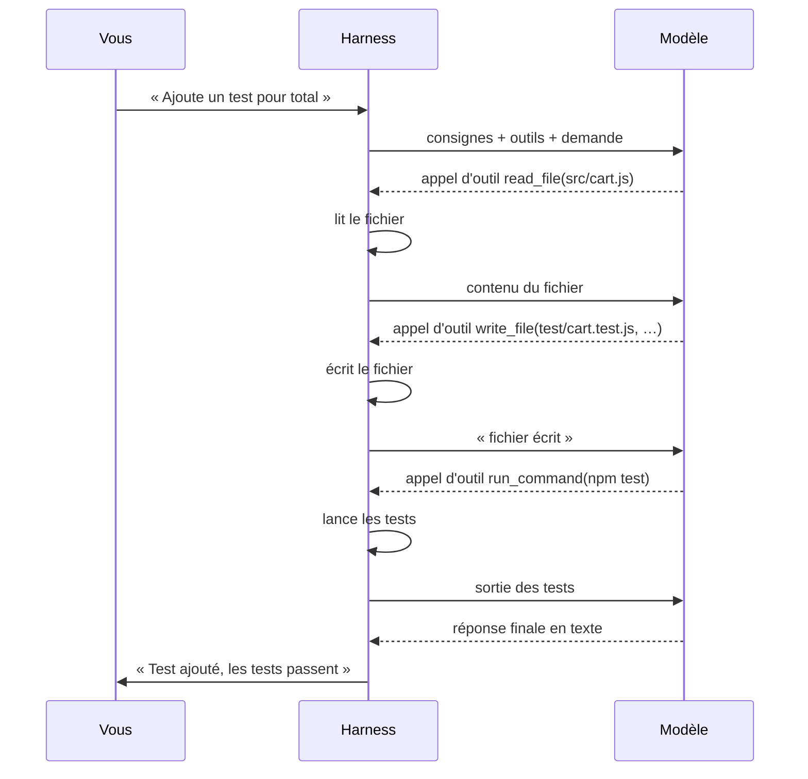

Un agent de code n'est pas un modèle qui « code tout seul ». C'est un programme, le **harness**, qui fait dialoguer un **modèle de langage** avec vos fichiers et votre terminal, en boucle, jusqu'à ce que la tâche soit finie. Comprendre cette boucle permet de choisir ses outils et de comprendre leurs limites.

**Pour qui** : un développeur qui a déjà vu un agent répondre, ou qui l'a installé avec le lab [Préparer son poste pour coder avec un agent d'IA](https://byte-layers.com/fr/labs/ai-agent-workstation). Aucune connaissance du fonctionnement interne des modèles n'est supposée.

# La boucle d'un agent de code : modèle, harness, éditeur

Trois mots reviennent dans tout ce qui suit :

| Mot | Ce que c'est | Exemple |
|---|---|---|
| **Modèle** (LLM, *Large Language Model*, grand modèle de langage) | un programme qui reçoit du texte et produit la suite la plus probable. Il ne lit aucun fichier et n'exécute rien lui-même | `qwen3.5:4b` servi sur votre poste par Ollama (un serveur de modèles locaux), un modèle de Mistral ou d'Anthropic dans le cloud |
| **Harness** | le programme qui envoie vos demandes au modèle, exécute ce que le modèle demande, et lui renvoie le résultat | Claude Code, OpenCode, Kilo, DeepSeek Harness |
| **Éditeur** (IDE, *Integrated Development Environment*) | l'endroit où vous lisez et modifiez le code. Le harness peut y être intégré, ou non | VS Code, un éditeur dérivé de VS Code, un terminal |

## 1 - La boucle : le modèle propose, le harness exécute

Quand vous demandez « ajoute un test pour la fonction `total` », le modèle ne peut pas ouvrir le fichier : il n'a que du texte. Il répond donc par un **appel d'outil**, c'est-à-dire un message structuré qui dit « exécute l'outil `read_file` avec le chemin `src/cart.js` ». Le harness exécute l'outil, puis renvoie le contenu du fichier au modèle, qui peut alors demander l'outil suivant. Le schéma montre une demande complète :



Chaque flèche vers le modèle est une nouvelle requête, qui renvoie **toute** la conversation depuis le début. Une demande simple coûte donc souvent cinq à dix allers-retours, et une tâche complexe beaucoup plus : c'est pour cela qu'un agent est plus lent qu'une simple question à un chatbot, et plus cher quand le modèle est facturé à l'usage.

Un modèle qui ne sait pas produire d'appels d'outils fiables ne peut pas servir d'agent, quelle que soit la qualité de ses réponses en texte. C'est le premier critère à vérifier sur un modèle local : sa page sur le site d'Ollama ou sur Hugging Face (le site de référence des modèles ouverts) indique s'il prend en charge les outils (*tools*).

## 2 - Le contexte : tout ce que le modèle reçoit à chaque tour

Le modèle ne se souvient de rien entre deux requêtes. À chaque tour, le harness lui renvoie un texte complet, le **contexte**, qui contient :

1. les **consignes** du harness (le *system prompt*) : son rôle, ses règles, sa façon de répondre ;
2. la **description de chaque outil** disponible, avec ses paramètres ;
3. vos **instructions de projet**, s'il y en a : un fichier comme `AGENTS.md` à la racine du dépôt, que le harness lit et ajoute automatiquement ;
4. la **conversation** : votre demande, les appels d'outils, et leurs résultats (fichiers lus, sorties de commandes).

Ce texte se mesure en **tokens**, des morceaux de mots (un token vaut en moyenne trois ou quatre caractères en français). Le modèle ne peut pas en lire plus que sa **fenêtre de contexte**, qui va de quelques milliers à plus d'un million de tokens selon le modèle. Les deux premiers points coûtent cher à eux seuls : un harness envoie souvent plusieurs milliers de tokens de consignes avant même votre demande.

Quand la conversation dépasse la fenêtre, le harness doit en retirer une partie : il la résume, ou il oublie les premiers échanges. C'est une raison concrète de garder des tâches courtes et des fichiers d'instructions concis, et de démarrer une nouvelle conversation pour une nouvelle tâche.

## 3 - Les permissions : ce que le harness exécute sans demander

Le modèle propose des actions ; c'est le harness qui décide de les exécuter. La plupart des harness rangent les outils en trois catégories, avec des réglages par défaut qui varient d'un outil à l'autre :

| Catégorie | Exemples | Réglage prudent |
|---|---|---|
| Lecture | lire un fichier, chercher dans le dépôt | autorisé sans demander |
| Écriture | créer ou modifier un fichier | demander, au moins au début |
| Commande | lancer `npm test`, `git push`, `rm` | demander, et interdire les commandes destructrices ou qui lisent des secrets (`.env`) |

Les permissions sont la principale barrière entre une erreur du modèle et vos fichiers. Une phrase dans les instructions (« ne supprime jamais rien ») est une demande, que le modèle peut ignorer ; une règle de permission dans la configuration du harness est une garantie, appliquée avant l'exécution.

## 4 - Trois formes de harness

Les harness prennent trois formes, selon leur rapport à l'éditeur de code. La boucle est la même dans les trois ; ce qui change, c'est l'endroit où vous la pilotez.

| Forme | Comment on l'utilise | Exemples | Avantages et limites |
|---|---|---|---|
| **CLI** (*Command Line Interface*) ou **TUI** (*Text User Interface*, une interface plein écran dans le terminal) | une commande dans un terminal ; certaines ont aussi une interface web | Claude Code, OpenCode, Codex CLI, DeepSeek Harness | indépendant de l'éditeur, facile à automatiser, par exemple dans un pipeline d'intégration continue |
| **Éditeur dérivé** (*fork* : une copie modifiée de VS Code) | un éditeur complet, avec l'agent intégré | Cursor, Kiro | intégration la plus poussée, mais vous changez d'éditeur et dépendez de l'entreprise qui le maintient |
| **Extension d'éditeur** (IDE + plugin) | une extension ajoutée à votre éditeur habituel | GitHub Copilot, Kilo | vous gardez votre éditeur ; l'extension a moins de prise sur l'interface |

Certains fournisseurs proposent aussi un agent qui travaille **dans le cloud**, sur une copie du dépôt, et rend son travail sous forme de demande de fusion : c'est la même boucle, exécutée sur leurs serveurs au lieu de votre poste.

Beaucoup d'outils existent sous plusieurs formes (une extension **et** une CLI, par exemple). Le choix dépend donc moins de la forme que de deux questions : quels modèles l'outil accepte-t-il, et où part votre code ?

## 5 - Brancher un harness sur un modèle

Un modèle dans le cloud ou sur votre poste s'interroge par une **API** (*Application Programming Interface*) : une adresse web qui reçoit des requêtes et renvoie des réponses. Pour lui parler, un harness a besoin de trois informations :

| Information | Exemple dans le cloud | Exemple en local avec Ollama |
|---|---|---|
| l'**adresse** de l'API (*base URL*), c'est-à-dire l'URL à laquelle le harness envoie ses requêtes | `https://api.mistral.ai/v1` | `http://localhost:11434/v1` |
| une **clé d'API**, qui identifie votre compte et sert à facturer | une clé créée dans la console du fournisseur | une valeur quelconque : Ollama ne vérifie rien |
| le **nom du modèle** | le nom donné par le fournisseur | `qwen3.5:4b` |

La plupart des fournisseurs et des serveurs locaux comprennent le même format de requêtes, celui de l'API d'OpenAI, dit « compatible OpenAI ». C'est ce qui permet de passer un harness d'un modèle dans le cloud à un modèle sur votre poste en changeant ces trois valeurs, sans rien réinstaller. Certains harness, en revanche, ne parlent qu'aux modèles de l'entreprise qui les publie : c'est un critère de choix.

## Récap

- Le **modèle** propose, le **harness** exécute : un agent est une boucle d'appels d'outils, un aller-retour par action.
- À chaque tour, le modèle relit tout le **contexte** : consignes, outils, instructions du projet, conversation. Sa **fenêtre de contexte** limite la longueur d'une tâche.
- Les **permissions** du harness protègent vos fichiers ; une consigne écrite n'est qu'une demande.
- Un harness prend trois formes : **CLI**, **éditeur dérivé**, **extension**. Il se branche sur un modèle avec une **adresse**, une **clé** et un **nom de modèle**.

> 📖 [Construire des agents efficaces (Anthropic)](https://www.anthropic.com/engineering/building-effective-agents) · [L'appel d'outils dans Ollama](https://docs.ollama.com/capabilities/tool-calling) · [L'API compatible OpenAI d'Ollama](https://docs.ollama.com/api/openai-compatibility) · [Le format AGENTS.md](https://agents.md/)

```quiz
title: La boucle d'un agent de code
tracksProgress: true
submitMode: last-only
questions:
  - prompt: Vous demandez à un agent de corriger un bug dans un fichier. Qui lit réellement le fichier sur le disque ?
    answers:
      - "Le modèle, qui a accès à votre dossier"
      - "Le harness, après que le modèle a demandé l'outil de lecture"
      - "L'éditeur, qui envoie tout le projet au modèle au démarrage"
      - "Personne : le modèle devine le contenu"
    correct: 2
    explanation: |
      Le modèle ne produit que du texte. Il répond par un appel d'outil (lire tel fichier),
      que le harness exécute avant de lui renvoyer le contenu.
  - prompt: Pourquoi une demande simple à un agent prend-elle souvent plus de temps qu'une question à un chatbot ?
    answers:
      - "Parce que chaque action (lire, écrire, lancer les tests) est un nouvel aller-retour avec le modèle, qui renvoie toute la conversation"
      - "Parce que l'agent utilise toujours un modèle plus gros"
      - "Parce que le harness attend une validation humaine pour chaque lecture"
      - "Parce que l'agent télécharge le modèle à chaque demande"
    correct: 1
    explanation: |
      Une tâche se fait en plusieurs tours de boucle, et chaque tour renvoie tout le contexte
      au modèle.
  - prompt: Un modèle local donne d'excellentes réponses en texte mais ne sait pas produire d'appels d'outils. Que peut-il faire dans un harness ?
    answers:
      - "Tout, plus lentement"
      - "Écrire des fichiers, mais pas lancer de commandes"
      - "Répondre à des questions, mais pas agir sur vos fichiers"
      - "Remplacer le harness"
    correct: 3
    explanation: |
      Sans appels d'outils, le modèle ne peut que répondre en texte : il ne peut demander ni
      lecture, ni écriture, ni commande.
  - prompt: Vous écrivez « ne lis jamais le fichier .env » dans le fichier AGENTS.md du projet. Qu'avez-vous obtenu ?
    answers:
      - "Une garantie : le harness bloquera la lecture"
      - "Une demande ajoutée au contexte, que le modèle peut ne pas respecter"
      - "Rien : AGENTS.md n'est jamais lu"
      - "Le chiffrement du fichier .env"
    correct: 2
    explanation: |
      Les instructions entrent dans le contexte du modèle. Seule une règle de permission dans
      la configuration du harness est appliquée avant l'exécution.
  - prompt: Pour passer un harness d'un modèle dans le cloud à un modèle servi par Ollama, que faut-il changer en général ?
    answers:
      - "Réinstaller le harness dans sa version locale"
      - "L'éditeur de code"
      - "Le format des fichiers du projet"
      - "L'adresse de l'API, la clé et le nom du modèle"
    correct: 4
    explanation: |
      Ollama parle le format compatible OpenAI, comme la plupart des fournisseurs : on change
      l'adresse (http://localhost:11434/v1), la clé (quelconque) et le nom du modèle.
```
