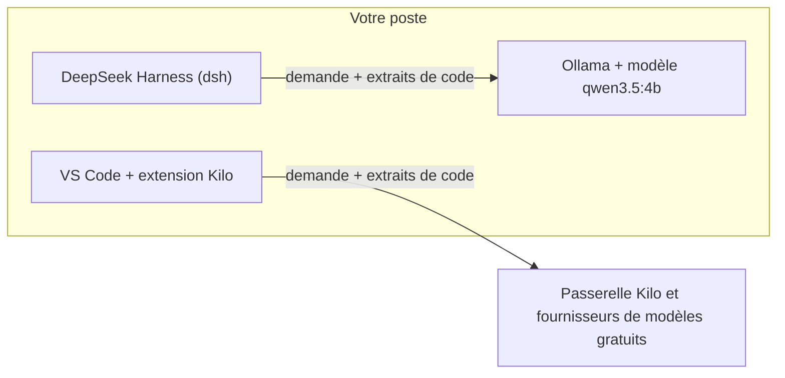

Un **agent de code** est un programme qui reçoit une demande en langage naturel (« ajoute un test pour cette fonction »), la confie à un **modèle de langage** (un LLM), puis exécute les actions que le modèle propose : lire un fichier, en écrire un, lancer une commande. Le programme qui fait tourner cette boucle s'appelle le **harness**. Le modèle, lui, peut tourner dans le cloud ou sur votre poste.

## 01.1 - Deux outils, deux philosophies

Vous installez deux harness qui s'opposent sur un point : **où part votre code**. Le schéma ci-dessous montre le chemin d'une demande dans chacun d'eux.



Le tableau résume ce qui les distingue.

| | Kilo dans VS Code | DeepSeek Harness + Ollama |
|---|---|---|
| Type de harness | une **extension** dans un éditeur (IDE + plugin) | un **harness autonome**, avec une interface web |
| Où tourne le modèle | dans le cloud, chez des fournisseurs de modèles gratuits | sur votre poste, servi par Ollama |
| Compte | un compte Kilo gratuit | aucun |
| Où part votre code | chez ces fournisseurs, qui peuvent conserver les échanges | nulle part : tout reste sur le poste |
| Vitesse | rapide | dépend de votre machine ; lent sans carte graphique |

Avoir les deux permet de comparer, dans les labs suivants, le même travail confié à deux harness et à deux modèles différents.

> ⚠️ **Des données qui sortent.** Avec les modèles gratuits du cloud, considérez que tout ce que vous envoyez peut être conservé et réutilisé. N'y mettez ni code d'entreprise, ni données personnelles, ni secrets : les labs de ce stack utilisent des projets d'exercice.

## 01.2 - Créer le dossier de travail

Tous les labs du stack rangent leurs fichiers sous `~/byte-layers/ai`. Créez le dossier de ce lab. L'option `-p` crée aussi les dossiers parents qui manquent, sans erreur s'ils existent déjà :

```exec
mkdir -p ~/byte-layers/ai/setup
```

> 📖 [Qu'est-ce qu'un agent d'IA (Anthropic, « Building effective agents »)](https://www.anthropic.com/engineering/building-effective-agents) · [Documentation de Kilo](https://kilo.ai/docs) · [Documentation d'Ollama](https://docs.ollama.com/)

```verify
if [ ! -d ~/byte-layers/ai/setup ]; then
  echo "Le dossier ~/byte-layers/ai/setup n'existe pas. Lancez la commande mkdir de cette section."
  exit 1
fi
```
